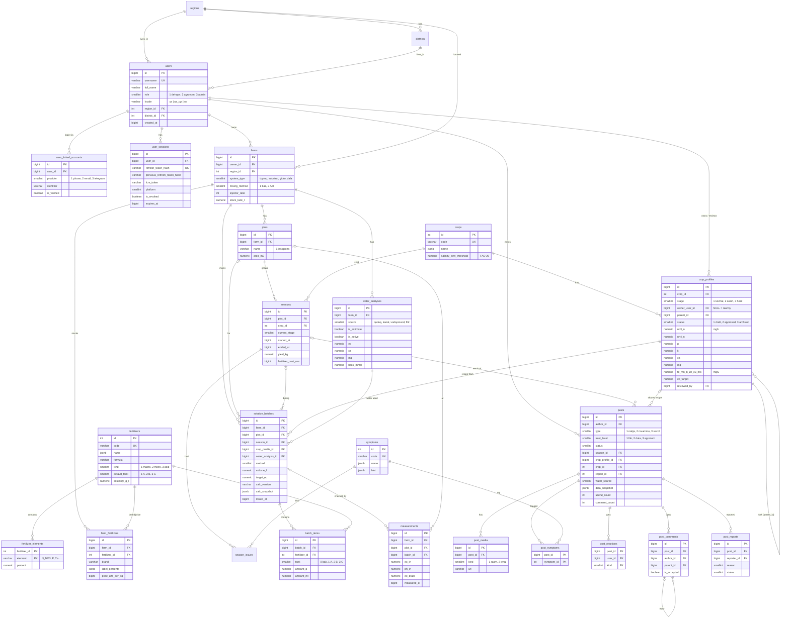

# Dehqon Bobo — ma'lumotlar bazasi (ERD)

PostgreSQL 16+. Migratsiyalar: `migrations/` (golang-migrate, `binary` loyihasi bilan bir xil format).

## Umumiy qoidalar (binary loyihasidan)

- **ID** — `BIGINT GENERATED ALWAYS AS IDENTITY` (ma'lumotnomalarda `INT`).
- **Vaqt** — `BIGINT` unix soniya (`created_at`, `updated_at`, `*_at`). Go tomonida `time.Now().Unix()`.
- **Enum** — `SMALLINT` + `COMMENT ON COLUMN`; qiymatlar Go'dagi `domain` enum'larida takrorlanadi.
- **Ko'p tilli nom** — `JSONB {"uz": lotin, "uz_cyr": kirill, "ru": rus}` (regions, districts, crops, fertilizers, symptoms).
- **OTP kodlar va urinishlar** — jadvalda emas, **Redis**'da (TTL bilan). Binary'dagi `AuthService` shunday ishlaydi.
- **Kimyoviy miqdorlar** — `NUMERIC`, float emas: retsept qayta hisoblanganda bir xil chiqishi kerak.

## Diagramma

## Bloklar

### 1. Identity — binary'dan ko'chirildi

| Jadval | Binary'dan farqi |
|---|---|
| `regions`, `districts` | O'zgarishsiz. Seed (`000006_seed_locations`) ham ko'chirildi. |
| `users` | `mentor_id` olib tashlandi. `role` ma'nosi: 1 dehqon, 2 agronom, 3 admin. Yangi: `locale`, `avatar_url`, `onboarded_at`. |
| `user_linked_accounts` | O'zgarishsiz (telefon / email / Telegram). |
| `user_sessions` | O'zgarishsiz. `previous_refresh_token_hash` va `expires_at` indeksi binary'ning 7 va 8-migratsiyalaridan birlashtirildi. |

OTP, urinishlar soni va Telegram login kodlari Redis'da saqlanadi. Ular uchun jadval yo'q.

### 2. Ma'lumotnomalar

- **`crops`**: ekin va FAO-29 bo'yicha suv sho'rlik chegarasi (`salinity_ecw_threshold`, dS/m). Bu qiymat retsept ekranidagi ogohlantirish uchun ishlatiladi.
- **`crop_profiles`**: ekin va bosqich uchun maqsad (mg/L) hamda EC.
  - `owner_user_id IS NULL` — rasmiy profil (agronom tasdiqlagan).
  - `owner_user_id` to'ldirilgan — dehqonning o'z profili. "Retseptni olish" bosilganda `parent_id` orqali nusxa (fork) yaratiladi.
  - `status = 2` va `reviewed_by` — agronom tasdig'i. Shu belgi ilovada "Agronom ko'rdi ✓" bo'lib chiqadi.
- **`fertilizers` + `fertilizer_elements`**: tuz va uning element tarkibi (%). Qiymatlar HPG'dagi standart foizlar. `default_tank` A/B/C bakka taqsimlash uchun, `solubility_g_l` konsentrat ogohlantirishi uchun.

### 3. Xo'jalik

- **`farms`**: birinchi sozlash va Profil ekranlari. Unda viloyat, tizim va aralashtirish usuli saqlanadi.
- **`plots`**: "Issiqxonalarim" ro'yxati.
- **`water_analyses`**: suv tahlili. Har bir xo'jalikda bitta faol tahlil bo'ladi (partial unique index). Eski tahlillar o'chirilmaydi, chunki eski retseptlar ularga bog'langan.
- **`farm_fertilizers`**: dehqon qopdagi yorliqdan kiritgan foizlar va narx (so'm/kg).

### 4. Mavsum va jurnal

- **`seasons`**: bitta issiqxonadagi bitta ekin sikli. Mavsum yakunida hosil (kg), maydon va xarajat to'ldiriladi, natija kartochkasi shulardan tuziladi.
- **`solution_batches`**: tayyorlangan har bir eritma. `calc_snapshot` hisob natijasini o'zgarmas holda saqlaydi: ppm, tuzlar, kislota va EC. `calc_version` esa formulalar versiyasi. Formula keyin tuzatilsa ham, eski jurnal yozuvlari o'zgarmaydi.
- **`batch_items`**: qaysi bakka qaysi tuzdan necha gramm solingani.
- **`measurements`**: EC, pH va drenaj o'lchovlari. Eritmaga yoki issiqxonaga bog'lanadi, bu ikkala holatni ham qamrab oladi: eritma tayyorlangandan keyingi o'lchov va bosh sahifadan qilingan oddiy o'lchov.

### 5. Hamjamiyat

- **`posts`**: postning turi (natija, muammo yoki savol) va ishonch darajasi.
  - `data_snapshot` — kartochkada ko'rinadigan raqamlar: kg/m², o'rtacha EC, o'lchovlar soni.
  - `region_id` va `water_source` post yozilgan paytdagi holatdan nusxa olinadi, shuning uchun dehqon keyin viloyatini o'zgartirsa ham "Mening sharoitim" filtri to'g'ri ishlaydi.
- **`post_reactions`**: "Foydali" reaksiyasi. `useful_count` va `comment_count` lenta tez yuklanishi uchun saqlanadigan hisoblagichlar.
- **`post_comments`**: izoh va javoblar. `is_accepted` — tasdiqlangan javob; bitta postda faqat bittasi bo'lishi partial unique index bilan ta'minlanadi.
- **`symptoms` + `post_symptoms`** (shuningdek `season_issues`): belgilar ro'yxati (Marschner manbasi bo'yicha). Postlarni belgi bo'yicha qidirish uchun.
- **`post_reports`**: moderatsiya — shikoyatlar.

## Keyingi bosqichga qoldirildi

- `notifications` va `reminders`. Hozircha `user_sessions.fcm_token` yetarli.
- `weather_cache`. Ob-havo API natijasi Redis'da saqlanadi.
- Agregat statistika, masalan "viloyatda shu profil bilan mediana hosil". Uni `seasons` asosida materialized view qilib yasaymiz.
